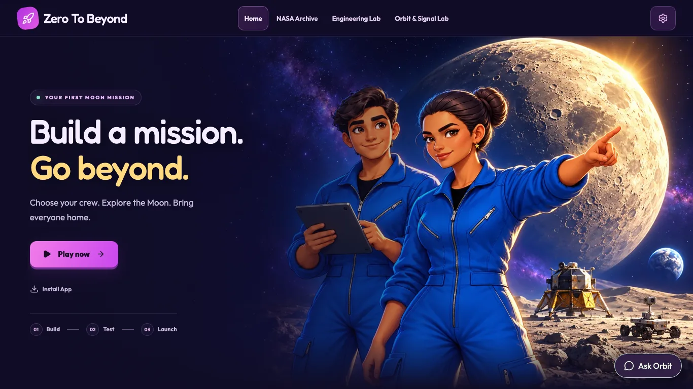

# Zero To Beyond

**Build a mission. Go beyond. Bring everyone home.**

Zero To Beyond is a story-driven space mission design game by **ExoVisionaries**, created for the **2026 NASA Space Apps Challenge — Space Mission Design Game**. It helps students, beginners and educators explore how scientific goals shape engineering decisions: what to build, what to carry and how to bring the crew home.

[Play online](https://zerotobeyond.pages.dev/) · [Space Apps project](https://www.spaceappschallenge.org/2026/find-a-team/team-exovisonaries/?tab=project) · [Project video](https://youtu.be/Md5HJVXqhIA) · [NASA data & credits](docs/SOURCES.md)



## The experience

Choose a water-ice or geology objective, plan a lunar expedition, assemble a lander and rover, select instruments and crew, and balance mass, power, fuel, supplies and budget. Complete readiness activities, launch, travel to the Moon, land, explore the surface and return to Earth for a mission debrief.

Character-guided explanations, hands-on activities, hints and retries help players experiment with the consequences of their choices. Progress is saved in the current browser; the Game menu offers **Resume** when a save is available and **New Game** with confirmation before replacing progress.

| Explore             | What you can do                                                                                                                            |
| ------------------- | ------------------------------------------------------------------------------------------------------------------------------------------ |
| **Moon mission**    | Build spacecraft, manage resources, fly, land, drive a rover, collect simulated evidence and recover the crew.                             |
| **Cosmic Explorer** | Explore Solar System bodies and spacecraft with NASA 3D models, compare distances and travel times, and browse the wider object catalogue. |
| **Engineering Lab** | Design a lunar survey spacecraft, test payload, power, storage and downlink choices, and export a mission blueprint.                       |
| **Signal Lab**      | Investigate a reference lunar communications scenario, relay visibility and signal delay.                                                  |
| **Archive**         | Browse spaceflight milestones, NASA imagery and mission references.                                                                        |
| **Roadmaps**        | Explore space careers and an introduction to university satellite missions, with official sources.                                         |

Contextual space keywords and linked media explain unfamiliar terms. **Orbit**, the optional Gemini-powered tutor, can answer questions about the current page.

## Play and controls

Use a WebGL-capable browser in **landscape**. A desktop or laptop is the primary play target; the rover chapter needs a keyboard and mouse. Compact landscape and tap-based assembly controls are included, but full touch-only and screen-reader support are not established.

- **Assembly and shelter:** drag items, or select an item and then its target.
- **Flight:** follow the displayed alignment, throttle and keyboard hints.
- **Rover:** W/S drive, A/D steer, E interact, M map, P/Escape pause, mouse drag to look, C center.
- **Install App:** use the browser's native install prompt when available, or the platform guide. Online APIs still need a connection.

## Run locally

Use **Node.js 22.12+** and **pnpm 11**. From the repository root:

```sh
pnpm install --frozen-lockfile
pnpm dev
```

Open the URL printed by Vite, normally `http://localhost:5173/`.

For Orbit, copy `.env.example` to `.env.local`, set `GEMINI_API_KEY`, and restart the dev server. Keep the key server-side; never prefix it with `VITE_` or commit it. The game runs without a tutor key. Production API routes require Cloudflare Pages Functions; see [deployment](docs/ci-cd.md).

```sh
pnpm run build          # TypeScript checks and production bundles
pnpm run lint
pnpm run format:check
node scripts/check-journey.mjs
node scripts/check-solar.mjs
node scripts/check-pwa.mjs
```

`pnpm test` runs lint, not a complete gameplay suite. See the [development guide](docs/development.md) for package boundaries, focused checks and asset preparation.

## Data, models and credits

NASA/JPL Horizons, lunar reference products and NASA mission publications support the game's visualizations and labs. [Sources and asset credits](docs/SOURCES.md) explain their use; each lab also exposes its assumptions and references.

Trajectories, engineering budgets, science readings and mission hazards are simplified educational models. They are not flight predictions, live space-weather alerts or new scientific discoveries. Reference data has bounded dates and coverage.

ChatGPT assisted development and authored content; Gemini powers Orbit without custom model training. NASA reference imagery, models and generated story artwork are credited separately. Third-party materials retain their respective rights. Zero To Beyond is an independent educational project, not an official NASA product or endorsement.

## Team ExoVisionaries

| Member               | Role                    |
| -------------------- | ----------------------- |
| Jannatul Nayem Esmy  | Team lead               |
| Priya Dev            | Research                |
| Shaulee Bose         | Research                |
| Muhammad Asif        | Application development |
| MD. Habibullah Galib | Solution design         |

Project background and team details are available on the [Space Apps project page](https://www.spaceappschallenge.org/2026/find-a-team/team-exovisonaries/?tab=project).

## Documentation

- [Development guide](docs/development.md) · [Cloudflare deployment](docs/ci-cd.md)
- [NASA data and media credits](docs/SOURCES.md)
- [Cosmic Explorer](docs/cosmic-explorer.md) · [Engineering Lab](docs/engineering-lab.md)
- [Moon Atlas, Signal Lab and Archive](docs/exploration.md)
- [Mission report](docs/moon-mission-report.md) · [Solar radiation activity](docs/solar-radiation.md)
- [Space keyword media coverage](docs/space-keyword-media.md)

Report reproducible problems through [GitHub Issues](https://github.com/asifhasan973/zerotobeyond/issues), including the game step, browser and reproduction steps. Remove keys and personal information from attachments.
