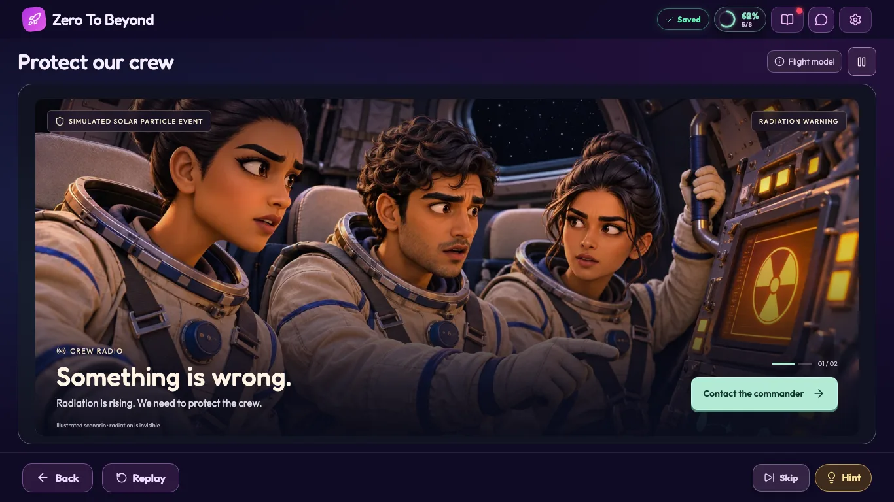
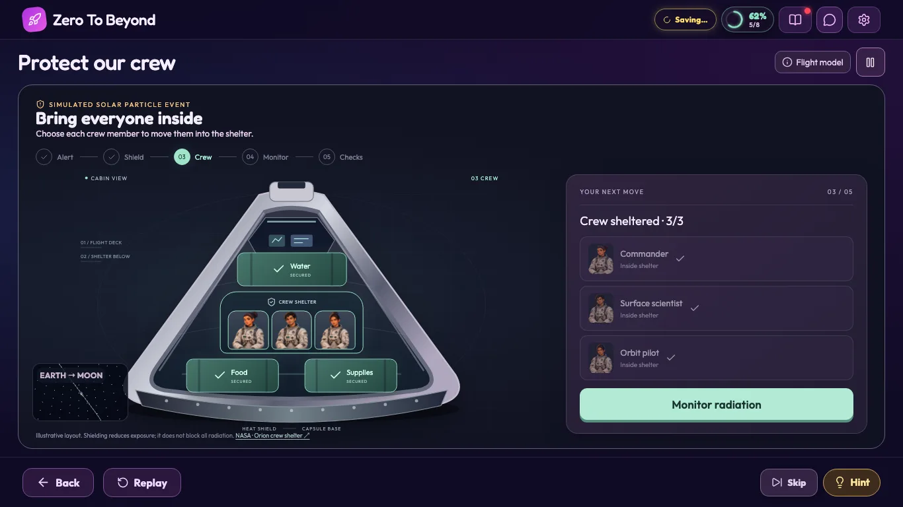
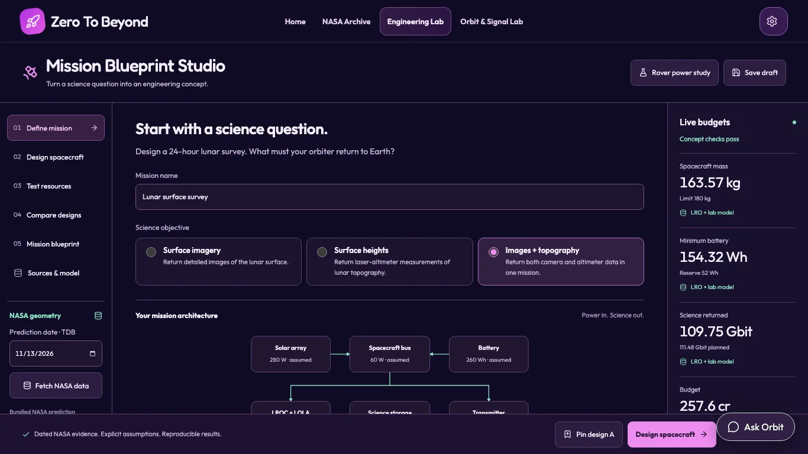

# Zero To Beyond

**Build a mission. Go beyond. Bring everyone home.**

An educational Moon mission game by **ExoVisionaries**, built for the NASA Space Apps **Space Mission Design Game** challenge. Players make engineering choices, assemble spacecraft, fly to the Moon, collect simulated scientific evidence and bring a three-person crew back to Earth.

[Play online](https://zerotobeyond.pages.dev/) · [NASA data & credits](docs/SOURCES.md) · [Run locally](#run-locally) · [Technical documentation](#documentation)


## Explore the project

- **Cosmic Explorer:** Explore measured Solar System, spacecraft, star and galaxy catalogue objects with a guided tour, distance comparisons and source notes. Open `/?explore=cosmic`; see [data and limits](docs/cosmic-explorer.md).

- **Moon mission:** Choose Ice or Geology, build a lander and rover, select instruments and crew, pack supplies, assemble a rocket, launch, fly the transfer, land, explore and return through splashdown.
- **Solar radiation challenge:** A two-scene illustrated warning leads into a playable cabin shelter. Position supplies, shelter the crew, monitor an illustrative 3D particle scene, then complete the all-clear checks. Skipping the preceding journey brings the player to the emergency instead of passing over it.
- **Engineering Lab:** Design a lunar survey spacecraft, balance payload mass, power, storage and downlink, compare designs and export a mission blueprint. A separate Power Study explores rover resources.
- **Orbit & Signal Lab:** Explore a precomputed lunar communications/navigation reference simulation.
- **NASA Archive:** Browse spaceflight history, mission references and NASA images.
- **Learning tools:** Contextual Space keywords show images/videos; Orbit, a Gemini-powered tutor, explains the current page and answers science questions.
- **Saved progress:** Browser saves, contextual Back/Replay, hints and explicitly assisted Skip/auto-build actions support learning at the player's pace.

| Storm warning                                                         | Cabin shelter                                                                 |
| --------------------------------------------------------------------- | ----------------------------------------------------------------------------- |
|  |  |



## Play and controls

A **WebGL-capable desktop or laptop browser in landscape** is the primary play target. Compact landscape layouts and tap-based assembly/shelter controls are included; the rover driving chapter requires a keyboard and mouse. This is not a claim of complete touch-only or screen-reader support.

| Activity                 | Controls                                                                                            |
| ------------------------ | --------------------------------------------------------------------------------------------------- |
| Assembly and shelter     | Drag, or select an item and then its target; native buttons support keyboard activation             |
| Departure / arrival burn | On-screen alignment and throttle controls; follow the displayed keyboard hints                      |
| Rover                    | W/S drive, A/D steer, E interact/charge, M map, P/Escape pause, mouse drag look, C center           |
| Navigation               | Back visits earlier steps; Replay restarts the current activity and clears dependent later progress |

Progress is stored on the current browser/device, not in an online player account. Orbit conversation history is kept in memory. Install the PWA from the app for a standalone view; online APIs still require a connection.

## Run locally

Use **Node.js 22.12+** and **pnpm 11**. Run commands from the repository root:

```sh
pnpm install --frozen-lockfile
pnpm dev
```

Open the URL printed by Vite, normally `http://127.0.0.1:5173/`. If that port is occupied, Vite may select another port.

### Optional Orbit tutor

Copy `.env.example` to `.env.local` in the repository root and set your own server-side key:

```dotenv
GEMINI_API_KEY=your_key_here
GEMINI_MODEL=gemini-3.5-flash-lite
```

Restart the development server after changing these values. Never prefix the key with `VITE_`, commit it, or include it in screenshots. The game can run without a key; Orbit will report that it is not configured. Model access depends on the provider account.

The Vite development middleware serves `/api/tutor` and `/api/engineering/horizons`. For production, deploy the root `functions/` directory with Cloudflare Pages and configure the Gemini key as a Pages secret. Static-only hosting does not provide these API endpoints. See [deployment setup](docs/ci-cd.md).

## Verify changes

```sh
pnpm run build          # TypeScript project checks and production bundles
pnpm run lint
pnpm run format:check
node scripts/check-journey.mjs  # Transfer, fuel, shelter, skip and save/replay checks
```

The production frontend is generated in `apps/web/dist/`. `pnpm test` currently runs the lint pipeline; it is not a full gameplay test suite. Browser checks and screenshots do not replace physical-device or accessibility testing.

## NASA data and scientific boundaries

NASA/JPL Horizons supplies celestial geometry; LRO/LOLA, Diviner, GRAIL, SPICE and NASA reference documents support the labs and visualizations. Reference products and their use are listed in [NASA data & credits](docs/SOURCES.md) and the in-app source notes.

Spacecraft trajectories, budgets, costs, instrument outcomes, shelter progression and entry/recovery animations are educational models. A simulated sample reading is not a NASA discovery. The solar event is authored, not a live warning; visible particles explain radiation that is invisible in reality. The shelter illustration is not a flight-qualified design. Historical and bundled reference data retain their stated dates and limitations.

ChatGPT assisted development, content and authored visual/audio assets. The Gemini API powers Orbit using questions, recent conversation history and current-page text; no custom model training is claimed. NASA reference imagery and generated story artwork are credited separately. Third-party materials retain their respective rights. This project is not an official NASA product or endorsement.

## Repository structure

```text
apps/web/             React application, game screens, public assets and Vite middleware
  src/game/moon/      Mission state, gameplay, 3D scenes and learning tools
  src/features/       Engineering, exploration and archive pages
  server/             Tutor and NASA Horizons API handlers
functions/api/        Production Cloudflare Pages API entry points
packages/data/        Mission catalogs, historical records and reference snapshots
packages/engine/      Physics, engineering calculations and asset utilities
packages/audio/       Audio synthesis and shared audio state
packages/ui/          Shared loading, orientation and interface primitives
packages/tsconfig/    Shared TypeScript configurations
docs/                 Technical documentation, source notes and screenshots
scripts/              Focused verification tools
```

## Documentation

- [NASA data, media and references](docs/SOURCES.md)
- [Engineering Lab and model assumptions](docs/engineering-lab.md)
- [Orbit & Signal Lab / location references](docs/exploration.md)
- [Mission report and evidence mapping](docs/moon-mission-report.md)
- [NASA Archive](docs/mission-archive.md)
- [Solar radiation gameplay](docs/solar-radiation.md)
- [Architecture](docs/monorepo-architecture.md) · [Navigation](docs/site-navigation.md)
- [Loading](docs/loading-screen.md) · [PWA](docs/pwa-integration.md) · [Deployment](docs/ci-cd.md)

Report a reproducible problem through [GitHub Issues](https://github.com/asifhasan973/zerotobeyond/issues). Include the game step, browser, viewport and reproduction steps; remove keys and personal information from attachments.
